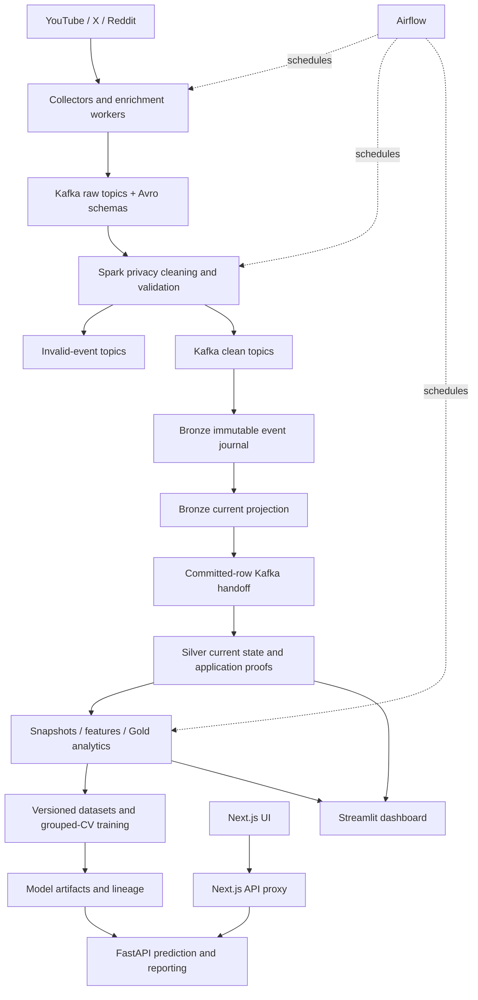

# Project overview and implementation status

Reviewed on **6 November 2026** against the commits in [SOURCE_PROVENANCE.md](SOURCE_PROVENANCE.md).
This document separates implemented code, historical experimental evidence, and runtime
verification. A component being implemented does not prove that its production deployment
or dataset is currently healthy.

## 1. Purpose and achieved scope

The project combines social-media data engineering and explainable machine learning for
electric-vehicle marketing. It collects YouTube, X, and Reddit observations; normalizes
and protects data; maintains replayable history; builds analytical/training datasets;
predicts high-engagement propensity; and presents explanations and marketing reports.

Three interfaces serve different needs:

- **Next.js product frontend:** analyze proposed posts, compare platforms and text
  variants, inspect model factors, request reports, and retain browser-local history.
- **Streamlit operations dashboard:** inspect collected content, engagement, authors,
  lineage, quality, derived tables, and Airflow activity; configure collection and import files.
- **FastAPI AI service:** expose prediction, batch prediction, and reports through HTTP.

The most substantial completed work is the data pipeline and its reliability mechanisms,
the versioned training/evaluation infrastructure, and core prediction/reporting interfaces.
Product integration, verified model metadata, stronger empirical evaluation, and deployment
operations remain areas for completion.

## 2. Monorepo structure and deployment boundaries

```text
USER-BEHAVIOR-SOCIAL-MEDIA/
  frontend/               Next.js product UI and server API proxy
  dashboard/              Streamlit operations and analytics
  ml/
    preprocess/           Dataset preparation
    features/             Content, topic, and exploratory role features
    train/                Training, calibration, evaluation
    serve/                Model inference and explanation
    server/               FastAPI service
    report_ui/            Template/Ollama report generation
    results/              Stored evaluation and lineage evidence
    models/               Local model artifacts, ignored by Git
  playwright/             Collectors and enrichment workers
  common/                 Shared contracts, state, outbox, reproducibility
  schemas/                Avro schemas
  spark/jobs/             Cleaning, lakehouse, analytics, quality, maintenance
  orchestrator/dags/       Airflow workflows
  scripts/                Setup and operational tooling
  tests/                  Unit, contract, Spark, Airflow, E2E tests
  deployment/             Image/Compose deployment bundles
  docs/                   Architecture, runbooks, and project review
  docker-compose.yml      Data-platform and backend services
  package.json            Root frontend commands
```

One repository coordinates source changes; deployment units remain independent: frontend,
AI API, and the data platform. Backend paths were retained because Docker mounts, Airflow
commands, tests, and training manifests depend on them. Moving everything into a new
`backend/` folder would require a separate, extensive migration.

`API/` is an older utility folder. The active prediction service is `ml/server/`.
The frontend is now ordinary tracked source, not a nested repository or submodule.

## 3. End-to-end flow



The product frontend does not connect directly to Kafka, Spark, or MinIO. Existing model
artifacts can be served without running collection. The data platform can likewise operate
without the Next.js application.

## 4. Collection and enrichment

### YouTube

Collection is divided into bounded workers with independent state and retry behavior:

- Discovery uses `search.list`, structured query/language pairs, persistent watermarks,
  and overlap windows. Routine discovery and explicit backfill are separate modes.
- Metadata uses `yt-dlp` without downloading video media and retains normalized/source data.
- Transcript, comment, and channel workers have separate request/result topics, batches,
  attempts, cooldowns, and outcome states.
- Channel statistics are cached by channel identity instead of repeatedly reopening videos.
- Engagement refresh uses `videos.list` statistics in batches of up to 50 video IDs.
- Thumbnails are validated HTTPS references; the pipeline does not download their image bytes.
- Optional transcript fallback needs its own configuration, credentials, and budget.

SQLite state and a transactional outbox bind worker progress to pending Kafka publication.
Publish intent is marked delivered after broker acknowledgement. Quota consumption, caches,
queue age, attempts, and cooldowns are observable rather than hidden in one crawler loop.

### X and Reddit

X collection uses a browser session through CDP. Windows helpers support a persistent Edge
profile and the host/container connection. A valid authenticated session is a prerequisite;
cloning source does not create one. Queries, limits, scrolling, and timeouts are configurable.

Reddit collection uses pages/JSON and supports configured authentication cookies where
needed. Subreddits, keyword filters, scan limits, and publication batches are configurable.
Reddit score stays source-specific. Community membership is not automatically equivalent
to an author's follower audience.

### Shared event contract

Events retain source/platform identity, content relationships, text, engagement counters,
publication time, observation time, and independent enrichment outcomes. Unknown counts
remain null; observed zero is zero. Root posts/videos are content, and actual comments or
replies are interactions. Missing captions are distinguishable from failed metadata.

## 5. Privacy, storage, and recovery

Privacy cleaning occurs **before Bronze**. Regex rules redact detected emails, mentions,
phone numbers, IP addresses, and embedded URLs; text normalization removes HTML/control
characters. Source user IDs receive salted SHA-256 hashing. This is implemented rule-based
processing, not a deployed NER model or a guarantee of complete irreversible anonymization.

Raw events use Avro with Schema Registry framing. The stream resolves writer schema IDs
to handle retained records written with older schemas. Invalid records go to source-specific
dead-letter flows with diagnostic evidence.

| Table or layer | Responsibility |
|---|---|
| Raw Kafka topics | Retained source observations for processing and retry |
| `lakehouse.bronze.event_log` | Insert-only journal keyed by deterministic event ID |
| `lakehouse.bronze.events` | Compatible current Bronze projection |
| `lakehouse.bronze.ingress_dlq` | Protected invalid-input evidence |
| `lakehouse.silver.events` | Canonical merged current state |
| `lakehouse.silver.applied_events` | Proof that a journal event was applied |
| `lakehouse.silver.engagement_snapshots` | Append-only observations over time |
| `lakehouse.silver.contents`, `interactions` | Root content and interaction relationships |
| `lakehouse.silver.transcripts`, `post_features` | Enriched text and model-oriented features |
| `lakehouse.gold.training_examples`, `dataset_manifests` | Versioned training inputs/provenance |
| Gold aggregates and monitoring tables | Analytics, data quality, quota, and pipeline health |

Abbreviated names in paired cells retain the first table's catalog/schema prefix. Defining
or reading a table in code does not prove that it currently contains data on this machine.

Bronze journal writing and handoff share one `foreachBatch` callback: commit the journal,
update the projection, reread committed rows, then publish. Silver merges idempotently and
inserts application proof after the merge. Failed handoffs and missing proofs can therefore
be retried using deterministic identities.

Reconciliation compares the journal and application proofs and can report/repair missing
applications. Producers use idempotence and all-replica acknowledgement. These are explicit
recovery guarantees; they are not a single global transaction across Kafka and Iceberg.

## 6. Analytics and quality

Repeated observations distinguish publication time from measurement time and support
velocity, acceleration, ratios, and delayed labels. Refresh jobs select due targets; a
30-minute schedule does not mean every stored post is fetched every 30 minutes.

Derived content/user aggregates, balanced analysis samples, transcript tables, and quality
outcomes are exposed through Streamlit. Quality rules retain severity and evidence. An empty
run can be recorded without counting old rows as newly processed data.

Analysis sampling and official training are different outputs. Balanced source counts alone
do not establish scientifically valid labels, splits, or temporal generalization.

## 7. Stage 1: prediction before publication

Stage 1 combines text-derived/structural features, source indicators, and a content score
in XGBoost. The content model uses TF-IDF and logistic regression; topics use TF-IDF/NMF.
Calibration adjusts probabilities. Tree contributions/SHAP provide ranked factors.

The current official path uses author-grouped cross-validation. Vectorizers and topic models
fit within training folds; inner grouped predictions support content/calibration fitting;
outer out-of-fold predictions supply evaluation. Decision thresholds are selected using
calibration data and stored in the model, rather than universally fixed at 0.5.

Official training excludes audience features when no historical measurement is proven to
precede publication. Counts observed after a post becomes successful can leak the outcome.
The current official grouped-CV path also excludes exploratory rhetorical-role features.
Manual/older model families can still use them; their role labels are heuristic silver
annotations, not an independently human-validated linguistic gold standard.

The API accepts audience for artifact compatibility. That does not establish that every
model uses it. Serving also does not treat Reddit community size as author audience.

### Virality label contract

`dataset-v3-*` freezes a per-platform threshold in engagement-score space. Available,
nonnegative counters contribute `log1p(counter)`; the sum is divided by the square root
of the number of observed counters. The default delayed label uses the earliest observation
at/after T+24 hours, within a further 24-hour tolerance.

`platform_reference_quantile` requires an independently pinned historical reference, which
is not supplied at this revision. Transitional `training_reference_quantile` estimates
thresholds from a designated author-grouped training partition and freezes them. It is not
evidence of temporal generalization. Minimum reference sizes must be chosen deliberately.

The ground-truth engagement threshold differs from the classifier probability threshold.
Under a frozen contract, unrelated evaluation rows cannot change an existing example's label.

### Reproducibility

Official runs preserve source Iceberg snapshots, dataset fingerprint, pinned Gold snapshot,
Git revision, dependency/runtime/container identity, resolved configuration, exact folds,
serialized model hash, and evaluation. Dirty trees and incomplete/legacy manifests fail
official requirements unless explicitly designated non-official. Uncommitted integration
work and the pre-existing untracked `summary.md` therefore need resolution before such a run.

## 8. Stage 2: prediction after publication

Dataset-building and training code exists for early engagement sequences. Defaults use
the first six hours, require at least two observations, and derive outcomes at/after 24 hours.
Dynamic features and a Stage-1 score refine the initial prediction. Missing early/late data
causes exclusion rather than fabricated observations.

This is an experimental training path, not a completed web feature. `/stage-2` redirects
home, and the reviewed FastAPI service exposes no Stage-2 endpoint. Its label/provenance
path still needs alignment with the newer frozen Stage-1 contract before claiming one
unified official protocol.

## 9. Service contract and frontend behavior

| Endpoint | Backend main | Product use |
|---|---|---|
| `GET /health` | Implemented | Model availability/cache diagnostics |
| `POST /predict` | Implemented | Cross-platform scoring and explanations |
| `POST /predict/batch` | Implemented | Variant comparison |
| `POST /report` | Implemented | Prediction and EN/VI report |
| `POST /report/jobs` | Missing | Client attempts submission, falls back on 404 |
| `GET /report/jobs/{job_id}` | Missing | Used only with a compatible queue backend |
| `POST /barriers` | Missing | Optional adoption-barrier card |
| `POST /greenwashing` | Missing | Optional environmental-claim risk card |
| `POST /sentiment` | Missing | Optional audience-reaction card |

Analyze scores the three platforms sequentially and initially reports on the highest score.
Additional analysis requests are serialized through an in-browser queue. It is memory-based,
not a durable queue that survives page closure. Supported report jobs are polled every second
with a ten-minute queue budget; the new proxy preserves fallback/error status codes and
adds bounded per-request timeouts.

Optional-card failures are handled separately, so the main report can still complete.
A history item marked completed does not prove every optional analysis succeeded.

`legacy` and `audience-x90` select independently cached artifacts. Missing weights produce
503. A healthy HTTP service is not necessarily a ready model: inspect each alias's
`available` state and perform a prediction. On this machine the default legacy file exists;
the default audience-x90 file is absent.

Reports use deterministic templates by default in Compose and the new local launcher.
Ollama is optional; a text-generation failure can fall back to a template with a warning.
ML produces the viral probability, not the LLM. The frontend does not currently expose
every extra backend warning field.

History uses localStorage, retains up to 200 entries, and supports search, filters, sorting,
pagination, reuse, deletion, detail view, and CSV export. It is not an account-backed,
cross-device campaign database. `/glossary`, like `/stage-2`, redirects home.

## 10. Interpreting stored results

| Evidence | Values | What can be claimed |
|---|---|---|
| `ml/RESULTS.md` section 0 and `stage1_evaluation.json` | Dataset v2: 197 examples; holdout 41; overall ROC-AUC 0.623; PR-AUC 0.193 | Pinned historical holdout result with small sample/wide intervals; not a newly executed v3 grouped-CV result |
| `multisource_cv_metrics.json` | 6,000 evaluated rows; OOF ROC-AUC about 0.793; PR-AUC about 0.630; `dataset_version: null` | Separate experiment without full current official dataset lineage |
| Frontend model constants/Insights | 3,990 and 58,020 rows; overall AUC 0.840 and 0.729 | Static presentation metadata, not verified identity/performance of installed weights |
| Landing-page examples | Fixed scores, factors, reports | Illustrative fixtures, not new inference results |

These numbers are not directly comparable without matching dataset, labels, features, and
evaluation protocol. No training was performed during integration. Older prose describes
obsolete labeling/holdout/role behavior; prioritize current implementation and the dedicated
virality/reproducibility contracts. The frontend still describes a 0.5 threshold in places,
although prediction labels come from the backend's model-specific threshold.

## 11. Airflow and operations

| DAG | Role | Default |
|---|---|---|
| `user_behavior_lakehouse` | Strict online run with new-row checks | Manual |
| `user_behavior_lakehouse_no_row_checks` | Online run that records/tolerates no new data | 60 minutes |
| `refresh_recent_engagement_insights` | Refresh due observations and growth signals | 30 minutes |
| `manual_file_import_lakehouse` | Process imported file events | On demand |
| `build_balanced_comment_dataset` | Reproducible analysis sampling | 1,440 minutes |
| `ai_train_pipeline` | Build pinned dataset and train Stage 1 | Manual |
| `iceberg_parquet_compaction` | Compact small files with row-count verification | 360 minutes |
| `docker_storage_maintenance` | Bound old containers/images/cache/logs | 1,440 minutes |
| `social_clean_pipeline` | Legacy sample CSV replay | Separate legacy flow |

Environment configuration can change schedules. Shared locks protect conflicting pipeline
writes/maintenance. Storage maintenance does not prune Docker data volumes.

Compose defines MinIO, Kafka, Schema Registry, Kafdrop, Spark, Airflow/PostgreSQL, Streamlit,
AI serving, and opt-in training. Release/image/bundle workflows exist; this review did not
verify production deployment or the current availability of every published image.

## 12. Refactor delivered in this workspace

- Imported frontend as regular monorepo source and preserved original provenance.
- Retained backend paths and excluded frontend/local analysis from backend Docker contexts.
- Added root npm shortcuts and frontend validation in the root GitHub Actions directory.
- Separated browser transport, domain API functions, and server proxy implementation.
- Replaced the browser's hardcoded private-network URL with a same-origin API path.
- Added server-side token forwarding, endpoint allowlisting, timeouts, no-store responses,
  redirect rejection, and sanitized connection errors with focused tests.
- Added local configuration/API startup helpers using host model paths and backend tokens.
- Removed build-time Google Fonts fetching after a reproducible external-font loader error;
  the interface now uses system fonts.
- Added English documentation for achievements, setup, source provenance, and publishing.

Missing endpoints and model artifacts have not been fabricated or silently substituted.

## 13. Next priorities

1. Align optional APIs, available-model metadata, threshold explanations, and report warnings.
2. Produce a complete official v3 grouped-CV run with enough independent authors and delayed
   observations for each platform, retaining the full lineage chain.
3. Validate Stage 2 on real sequences and align its label/reproducibility contract.
4. Decide whether durable queues, accounts, and centralized history are product requirements.
5. Configure independent deployments, access controls, service budgets, monitoring, and backups.

The proxy token is a service credential, not user authentication. See [RUNNING.md](RUNNING.md)
for startup and checks, and [PROJECT_ACHIEVEMENTS.txt](PROJECT_ACHIEVEMENTS.txt) for copy-ready prose.
